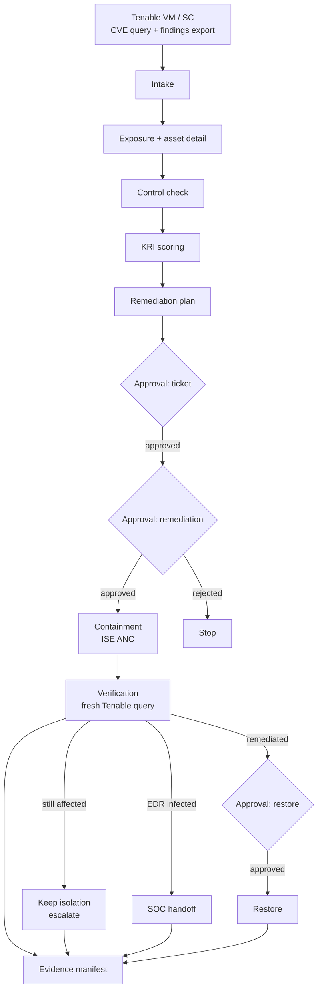

# SecOps Autopilot

**Carry a vulnerability from a Tenable finding to an approval-gated containment and a verified, evidenced fix.**

SecOps teams own the gap between "a CVE affects us" and "the fix is verified on every affected box." Closing it means stitching together the vulnerability scanner, the UCMDB, the EDR console, the patch-management portal, the NAC, and the ticketing system — then chasing owners by hand.

SecOps Autopilot automates that chain for **Tenable Vulnerability Management** and **Tenable Security Center**, stops at every state change for a recorded human approval, and produces an audit-ready evidence package as it runs.

It is an orchestration layer, not another scanner.

## What it does

| # | Stage | What happens | Output |
|---|---|---|---|
| 1 | Intake | Normalize a CVE and map it to Tenable plugins and findings | Typed vulnerability record |
| 2 | Exposure | Resolve affected endpoints and servers, with owner when a CMDB export is supplied | Asset list with source and confidence |
| 3 | Control check | Check Tenable agent presence, version/feed where exposed, EDR/AV/application-control posture where an inventory exists | Per-asset control posture with explicit unknowns |
| 4 | KRI scoring | Rank by severity, exploit maturity, exposure, control gap, and asset criticality | Transparent 0–100 KRI and work queue |
| 5 | Remediation | Select the patch path and compensating controls matched to the exploit mechanism | Plan with unverified controls called out |
| 6 | Ticket | Create the ITSM ticket and record infosec approval | Ticket bound to the plan SHA-256 |
| 7 | Containment | Quarantine non-compliant devices via Cisco ISE ANC | Isolation event, or a blocked record when the MAC is unknown |
| 8 | Verification | Re-query Tenable after remediation | Verified fix, open items, or EDR/SOC escalation |
| 9 | Evidence | Emit the full decision and action record | Markdown + HTML report and SHA-256 manifest |

## KRI coverage

The engine maps directly to the KRI process it was built for:

| KRI requirement | Where it is handled |
|---|---|
| 1. Agents and controls installed on endpoints and servers | Stage 3 — Tenable `has_agent`, agent records when the API scope permits, EDR/AV from an optional control inventory |
| 2. Latest version, signature feed, application-control modes | Stage 3 — values recorded when a connector exposes them; otherwise `unknown` with the exact reason |
| 3. Compensating controls/workarounds, ITSM ticket, infosec approval, team routing | Stage 5 plan, stage 6 ticket, approval ledger; owner routing from `owners.csv` when supplied |
| 4. Ticketing → NAC isolation → patch/AV → restore or infected EDR/SOC handoff | Stages 6–8; infection is an explicit branch, never inferred |
| 5. Alert | High/critical KRI, containment, verification failures, and EDR infections emit alert records |
| 6. Waiting for action | Run status, explicit `next_actions`, and approval ledger |
| 7. Reporting | Per-stage JSON, Markdown/HTML report, SHA-256 manifest |

## Live vs simulated

| Component | Default | Notes |
|---|---|---|
| Tenable Vulnerability Management | **Live** | Validated against a Tenable lab tenant: CVE-scoped queries, per-asset export, asset detail, agent scope probe |
| Tenable Security Center | Adapter implemented | Documented `/rest` API shape, not live-tested in this environment |
| ITSM | Simulated | Tickets in `.state/itsm.json`; the ticket/approval flow is real in the run record |
| Cisco ISE NAC | Simulated by default | Real ERS ANC adapter activates when `ISE_URL`, `ISE_USERNAME`, and `ISE_PASSWORD` are set |
| EDR | Simulated | Returns `unknown` unless a status fixture or a real connector is supplied; never claims "clean" |
| SIEM alerts | Simulated | Alerts are recorded locally; no SIEM is contacted |

Every simulated action is labelled `simulated: true` in the run record and in the reports.

## Quickstart

### Prerequisites

- Python 3.10+
- A Tenable Vulnerability Management API key pair, or Security Center API keys
- No scanner installation and no Tenable agent required

```bash
git clone https://github.com/sword0x00/SecOps-Autopilot.git
cd SecOps-Autopilot
python3 -m pip install -e .
cp .env.example .env
chmod 600 .env
# fill in TENABLE_ACCESS_KEY, TENABLE_SECRET_KEY, and a contact in TENABLE_USER_AGENT
```

Tenable requires a descriptive `User-Agent` on every API request. The engine sets
it on every call and records it in the evidence snapshot:

```
SecOps-Autopilot/0.1.0 (SWARM-Tenable-Hackathon; security-team@example.com)
```

### Verify access

```bash
secops doctor
secops inventory
```

`doctor` reports the tenancy, workbench read access, agent-inventory scope, and
the exact reason when an optional scope is unavailable.

### Run the read-only pipeline

```bash
secops run --cve CVE-2017-0144
```

This performs intake, exposure, control check, KRI scoring, and remediation
planning. It creates **no** ticket, **no** containment, and **no** external state
change. The run stops and prints the first approval command.

### Pass the gates (state-changing)

```bash
secops approve --run <RUN_ID> --gate ticket --approver "Your Name"
secops approve --run <RUN_ID> --gate remediation --approver "Infosec Approver" \
  --note "Approved for containment pending patch"
secops approve --run <RUN_ID> --gate containment --approver "SecOps Lead"
secops verify --run <RUN_ID>
secops report --run <RUN_ID> --format html --verify
```

Containment requires the remediation approval. Restore requires verified
remediation and a separate approval. A rejected remediation never executes
containment.

### Use owner and control inventories (optional)

```bash
secops run --cve CVE-2017-0144 \
  --owners examples/owners.example.csv \
  --controls examples/controls.example.csv
```

Both files are optional. Missing rows produce `unknown` with a reason; nothing
is inferred. See `examples/README.md` for the schema.

## What a run produces

```
runs/<run-id>/
  run.json                 complete run state: records, approvals, events
  report.md                human-readable evidence report
  report.html              self-contained, printable report
  stages/01-intake.json    one record per stage
  stages/02-exposure.json
  ...
  manifest.json            SHA-256 for every artifact
  manifest.sha256          sha256sum-compatible manifest
```

Verify the chain:

```bash
secops evidence --run <RUN_ID> --verify-only
```

The same report includes a "What this run did not do" section: no patch push, no
endpoint execution, no unapproved containment, no invented owner or control
state.

## Architecture



Connectors sit behind small interfaces:

- `VulnerabilitySource` — Tenable VM, Tenable SC, or a fake source in tests
- `ITSMConnector`, `NACConnector`, `EDRConnector` — simulated by default, real implementations pluggable
- `OwnerDirectory`, `ControlInventory` — optional CSV adapters for CMDB and control data

## Safety model

- **Read-only by default.** The pipeline performs no state change before the
  ticket gate.
- **Plan integrity.** Every approval records the remediation plan's SHA-256;
  changing the plan invalidates the approval.
- **Containment needs two approvals.** Ticket creation is one gate, infosec
  remediation approval is a second, and containment execution is a third.
- **No MAC means no NAC action.** ISE ANC keys on a MAC address. An asset without
  one is recorded as `blocked`; the engine does not guess an identity.
- **Unknowns are evidence.** Agent version, feed age, EDR state, AV state, owner,
  patch prerequisites, and rollback are recorded as `unknown` with a reason
  instead of being filled in.
- **Verification is a fresh read.** A finding that disappears after a rescan is
  the remediation evidence. A stale scan is not.
- **No secrets in artifacts.** Credentials are loaded from `.env`/environment,
  redacted before every write, and never included in request logs. Test coverage
  asserts this.

See [docs/security-and-safety.md](docs/security-and-safety.md) for the full model.

## Tenable integration

- Vulnerability Management: `GET /session`, `GET /workbenches/vulnerabilities`
  (CVE filter `plugin.attributes.cve.raw`), `POST /vulns/export` + status/chunks,
  `GET /assets/{uuid}`, `GET /scanners/agents`.
- Security Center: `GET /rest/currentUser`, `POST /rest/analysis`
  (`tool=vulndetails`, `filterName=cveID`), `GET /rest/asset/{id}`,
  `GET /rest/agent`.
- The required integration `User-Agent` is set in one shared transport.
- Rate limits use `Retry-After`; transient 5xx and network errors retry with
  exponential backoff. Concurrent export conflicts wait for the active job.

Full details, including the scope limitation observed on agent inventory:
[docs/tenable-integration.md](docs/tenable-integration.md).

## Scoring model

A KRI is a weighted blend of published severity, exploitability (Tenable VPR or
exploit signals), asset exposure (AES), control gap, and asset criticality (ACR).
Unknown components are excluded and the remaining weights renormalized; the
unknown list travels with the score.

Default weights: severity 0.35, exploitability 0.25, exposure 0.15, control gap
0.20, criticality 0.05. Containment candidates are high-KRI assets with an agent
absent, a control gap ≥ 4.0/10, or no patch path.

See [docs/kri-model.md](docs/kri-model.md).

## Testing

```bash
python3 -m unittest discover -s tests -v
```

The suite covers the live-adapter parsing, CVE filtering, KRI math, the full
approval chain, the blocked-containment branch, verification, plan tampering,
manifest integrity, and credential redaction. Tests use a fake Tenable source;
no tenant credentials are needed.

## Status and limitations

- The Tenable Vulnerability Management path is live-tested. The Security Center
  adapter follows the documented API and is clearly marked not live-tested.
- Agent inventory (`/scanners/agents`) returned HTTP 403 `Insufficient scope` on
  the lab credential. The engine records agent version/feed as `unknown` rather
  than inferring it from a flag.
- ITSM, NAC, EDR, and SIEM are simulated by default. The Cisco ISE ERS adapter is
  implemented but has not been exercised against a live ISE deployment.
- The engine does not patch, reboot, or execute on endpoints. It plans, gates,
  contains through the configured NAC, and verifies through the scanner.
- Asset owners and control health require a CMDB/EDR export; without one they are
  unknown.
- No exploit validation is performed. Tenable's findings are the source of truth.

## Repository layout

```
secops_autopilot/          engine, models, scoring, evidence, CLI
  connectors/              Tenable VM, Tenable SC, ITSM, NAC, EDR, SIEM
skills/                    Claude Code skills (intake, remediation planning)
.claude/agents/            orchestrator agent
playbooks/                 end-to-end chained workflow
examples/                  owner and control inventory schemas
docs/                      integration, KRI model, safety, demo script
submission/                CyberAgents Exchange listing draft
tests/                     unit and end-to-end tests with a fake Tenable source
```

## CyberAgents Exchange

This project is prepared for the Tenable CyberAgents Exchange as a **skill**
listing. The draft listing and submission checklist are in
[`submission/`](submission/). The repository is MIT licensed and contains no
credentials in tracked files.

## License

MIT — see [LICENSE](LICENSE).
