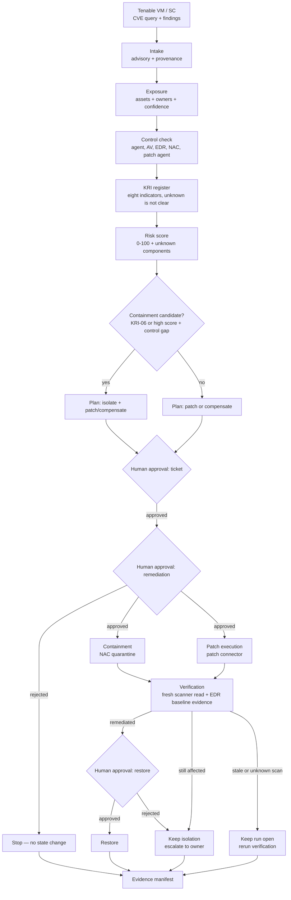

# SecOps Autopilot

**Carry a vulnerability from a scanner finding to an approval-gated containment,
a recorded remediation submission, and a verified, evidenced fix.**

SecOps teams own the gap between "a CVE affects us" and "the fix is verified on
every affected box." Closing it means stitching together the vulnerability
scanner, the asset inventory, the EDR console, the patch-management portal, the NAC, and the
ticketing system — then chasing owners by hand.

SecOps Autopilot automates that chain for **Tenable Vulnerability Management** and
**Tenable Security Center**, stops at every state change for a recorded human
approval, and produces an audit-ready evidence package as it runs. It is an
orchestration layer, not another scanner.

## What it does

The engine implements the ten operating stages from the SecOps Autopilot
methodology. Stage 9 and stage 10 of the source document are merged as
**Verification and recovery**: verification is a fresh read; restore is a
separate approval.

| # | Stage | What happens | Output |
|---|---|---|---|
| 1 | Risk intake | Normalize a CVE and optional advisory metadata; map it to scanner plugins and findings | Typed vulnerability record with provenance |
| 2 | Exposure | Resolve affected endpoints and servers, with owner when a asset inventory export is supplied | Asset list with source and confidence |
| 3 | Control check | Check agent presence, version/feed where exposed, EDR/AV/application-control/NAC/patch-agent posture where an inventory or connector exists | Per-asset control posture with explicit unknowns |
| 4 | KRI register + scoring | Detect the configured KRI register per asset, then rank by severity, exploit maturity, exposure, control gap, and asset criticality | Per-asset KRI matrix plus a transparent 0–100 risk score |
| 5 | Remediation | Select the patch path, advisory fixed version per runtime branch, and compensating controls matched to the exploit mechanism | Plan with target versions and unverified controls called out |
| 6 | Ticket + approval | Create the ticketing-system ticket and record infosec approval | Ticket bound to the plan SHA-256 |
| 7 | Containment | Quarantine non-compliant devices via Cisco ISE ANC | Isolation event, or a blocked record when the MAC is unknown |
| 8 | Remediation execution | Submit approved patch jobs with the per-asset target version through the patch connector | Job record; simulated by default, never a claim that a host was patched |
| 9 | Verification and recovery | Re-query the scanner after remediation; restore only verified devices after a separate approval | Verified fix or open items; EDR status recorded as baseline evidence |
| 10 | Evidence | Emit the full decision and action record | Markdown + HTML report and SHA-256 manifest |

## What, why, and value

### What it is

SecOps Autopilot is an orchestration layer for the work between a scanner
finding and a verified fix: it normalizes the vulnerability, resolves affected
assets, reads control posture, evaluates KRIs, builds an approval-gated
remediation plan, records containment and patch submission, verifies the result
with a fresh scan, and writes the evidence package.

It is not a scanner, an exploit framework, or a patch-delivery engine. It is the
control plane that makes those tools produce one defensible record.

### Why it matters

A vulnerability is not closed when a ticket is opened or a patch job is queued.
It is closed when a fresh scan confirms the finding is gone on every affected
asset, the control exceptions are recorded, and an approver can defend every
state change. Doing that by hand across a scanner, an asset inventory, an EDR,
a ticketing system, a NAC, and a patch manager is slow, inconsistent, and hard
to audit. The engine makes the sequence explicit and the unknowns visible.

### Illustrative value model

The following is a **transparent planning model, not a measured forecast**.
Replace the assumptions with your own before using it for a budget decision.

**Analyst workload allocation**

- **Analyst 1:** 5 days/month dedicated to ensuring all security controls are
  applied — 60 days/year, or 480 hours at 8 hours/day.
- **Analyst 2:** 12–15 days/month dedicated to end-to-end vulnerability
  management — 144–180 days/year, or 1,152–1,440 hours at 8 hours/day.
- Combined dedicated capacity: **1,632–1,920 hours/year** (0.89–1.04 FTE at
  1,840 productive hours per FTE; midpoint 1,776 hours).

**Assumptions**

- 30 KRIs are assessed every month: 12 cycles per year. The current catalog has
  eight KRIs; 30 is the scaling target.
- Manual effort per KRI per cycle: 10 hours (4 h collection, 2 h validation,
  3 h owner follow-up, 1 h reporting). **3,600 hours/year**, or 188–221% of the
  combined allocation; manual operation needs **1,680–1,968 additional
  hours/year**.
- Automated effort per KRI per cycle: 3.5 hours (1.5 h human review, 1.5 h
  follow-up, 0.5 h exception handling and reporting). **1,260 hours/year**,
  which fits the allocation with 372–660 hours/year left for other work.
- Loaded analyst cost: **$75/hour** (illustrative; substitute your rate).
- Implementation: **240 hours** one-time, or $18,000.
- Annual run cost: 0.25 FTE (460 hours) = $34,500, plus $6,000 infrastructure
  and $3,000 training = **$43,500/year**.

**Annual effect**

| Measure | Manual (30 KRIs) | Engine-assisted |
|---|---:|---:|
| Analyst hours required | 3,600 | 1,260 |
| Dedicated allocation | 1,632–1,920 | 1,632–1,920 |
| Allocation used | 188–221% | 66–77% |
| Additional capacity needed | 1,680–1,968 h | 0 |
| Incremental annual cost | $126,000–$147,600 | $43,500 |

**Cost and return**

Using the low end of the additional manual capacity (1,680 hours) as a
conservative case:

| Period | Avoided manual capacity | Cost | Net | Cumulative net |
|---|---:|---:|---:|---:|
| Year 1 | $126,000 | $61,500 (implementation + run) | $64,500 | $64,500 |
| Year 2 | $126,000 | $43,500 | $82,500 | $147,000 |
| Year 3 | $126,000 | $43,500 | $82,500 | $229,500 |

- Year-1 ROI: **105%**; payback: **~5.9 months**.
- Three-year ROI: **155%**; three-year net: **$229,500**.
- At the high end of the allocation gap (1,968 hours), year-1 net is $86,100 and
  payback is **~5.0 months**.
- At the current eight-KRI catalog, both the manual (960 hours/year) and
  engine-assisted (336 hours/year) workloads fit inside the allocation. The
  model above is the 30-KRI scaling case.

The financial return is only one part. The operating value is a consistent KRI
method, an approval record for every consequential action, explicit unknowns
instead of guessed values, a fresh-scan verification rule, and an evidence
manifest that answers "what did we do, when, and why?" without reconstructing it
from six consoles.

**Caveat:** the current catalog has eight KRIs, not 30. Reaching 30 is an
engineering/configuration effort. The model assumes the allocation above and
does not assume additional analyst headcount; it shows that manual operation at
30 KRIs would require temporary or contract capacity that the engine avoids.

## Stage contracts

Every stage declares its inputs, outputs, read-only/state-changing nature, and
approval gate. The contract is written into the evidence record, so the report
shows the authorization boundary instead of relying on a reviewer to remember it.

```bash
secops stages
```

Read-only stages run unattended. State-changing stages are reachable only through
`secops approve` with an explicit gate and a non-empty approver.

## KRI coverage

The engine evaluates eight named indicators. `unknown` is never treated as clear.

| ID | Name | Detection source | Route |
|---|---|---|---|
| KRI-01 | Missing security agent | Tenable `has_agent`; EDR/AV presence | Control gap / ticket |
| KRI-02 | Stale control version | Installed vs approved baseline | Control gap / ticket |
| KRI-03 | Stale threat feeds | AV/EDR feed age > 24h | Degraded detection / ticket |
| KRI-04 | Detect-only mode | AV/EDR/app-control mode | Compensation / ticket |
| KRI-05 | Unresolved exploitable vulnerability | Target CVE finding + finding state + exploit/patch signals | Patch / containment candidate |
| KRI-06 | NAC non-compliant posture | ISE/control-inventory posture | Containment candidate |
| KRI-08 | Vulnerable runtime version | CPE runtime version vs advisory affected range/fixed version | Exact target version / compensation if unsupported |
| KRI-09 | Externally exposed vulnerable service | Web port/service or asset exposure score | WAF/IPS or containment priority |

KRI-01 … KRI-04 detect the control-plane conditions. KRI-05 is generic to the
target CVE; it no longer assumes MS17-010. KRI-08 reads the runtime product and
version from CPE, so PHP and Node.js scenarios are assessed from evidence rather
than plugin-name text. KRI-09 uses port/service and AES; it records `unknown`
when neither is available.

**Baseline controls.** AV and EDR are baseline controls, not separate
active-compromise workflows:

| Control | What the engine checks | Change to the workflow |
|---|---|---|
| AV | Presence, version vs baseline, signature age, mode | No change; feeds KRI-01 … KRI-04 |
| EDR | Presence, version vs baseline, feed age, mode, status as evidence | No change; feeds KRI-01 … KRI-04 |

EDR status is recorded with the control posture and verification evidence. It
does not add an active-compromise response, a separate analyst handoff, or an
automatic isolation/restore rule.

## Live vs simulated

| Component | Default | Notes |
|---|---|---|
| Tenable Vulnerability Management | **Live** | Validated against a Tenable lab tenant: CVE-scoped queries, per-asset export, asset detail, agent scope probe |
| Tenable Security Center | Adapter implemented | Documented `/rest` API shape, not live-tested in this environment |
| Ticketing system | Simulated | Tickets in `.state/ticketing.json`; the ticket/approval flow is real in the run record |
| Cisco ISE NAC | Simulated by default | Real ERS ANC adapter activates when `ISE_URL`, `ISE_USERNAME`, and `ISE_PASSWORD` are set |
| EDR | Simulated | Returns `unknown` unless a status fixture or a real connector is supplied; never claims "clean" |
| Patch management | Simulated | Jobs in `.state/patch.json`; `touched_host=false`; never reports `patched` |

Every simulated action is labelled `simulated: true` in the run record and in the
reports. A submitted patch job is not remediation evidence; only a fresh scanner
read is.

## Installation

### 1. Install Claude Code

Claude Code is the recommended host for the agent and skills. Native installer:

- macOS, Linux, WSL: `curl -fsSL https://claude.ai/install.sh | bash`
- Windows PowerShell: `irm https://claude.ai/install.ps1 | iex`
- Windows CMD: `curl -fsSL https://claude.ai/install.cmd -o install.cmd && install.cmd && del install.cmd`

In WSL, run the Linux command inside the WSL terminal. Verify with
`claude --version` and `claude doctor`, then run `claude` and sign in. Claude
Code requires a paid Claude plan (Pro, Max, Ultra, Team, Enterprise, or Console).
Native installs update automatically; `claude update` forces an update.
Alternatives: Homebrew `brew install --cask claude-code`, WinGet
`winget install Anthropic.ClaudeCode`, or npm
`npm install -g @anthropic-ai/claude-code` (Node.js 22+, never with `sudo`).
Keep one installation; if `claude` is not found, add `~/.local/bin` to PATH.
Full platform requirements and Linux package-manager installs:
<https://code.claude.com/docs/en/setup>.

### 2. Install the Python engine

```bash
git clone https://github.com/sword0x00/SecOps-Autopilot.git
cd SecOps-Autopilot
python3 -m venv .venv
source .venv/bin/activate
python3 -m pip install -e .
```

This installs the `secops` console script and the `secops_autopilot` package.
Python 3.10+ is required. Runtime dependencies are `requests` and `Markdown`.

### 3. Install the Claude Code agent

The repository ships the orchestrator agent at
`.claude/agents/secops-autopilot.md`, which Claude Code discovers when the
repository is opened. To make it available in every project, copy it into the
user-level agent directory:

```bash
mkdir -p ~/.claude/agents
cp .claude/agents/secops-autopilot.md ~/.claude/agents/
```

### 4. Install the skills

Project-level skills (recommended when working in this repository):

```bash
mkdir -p .claude/skills
cp -R skills/vuln-intake skills/remediation-planning .claude/skills/
mkdir -p .claude/skills/secops-autopilot
cp SKILL.md .claude/skills/secops-autopilot/SKILL.md
```

User-level skills (available in every project):

```bash
mkdir -p ~/.claude/skills
cp -R skills/vuln-intake skills/remediation-planning ~/.claude/skills/
mkdir -p ~/.claude/skills/secops-autopilot
cp SKILL.md ~/.claude/skills/secops-autopilot/SKILL.md
```

Restart or reload the Claude Code session after copying agent/skill files. In
Claude Code, invoke the installed skill as `/secops-autopilot`.

### 5. Install and run the scripts

The package install provides `secops`. The repository scripts are run in place:

```bash
python3 scripts/live_php_node_batch.py --help
```

`scripts/live_php_node_batch.py` discovers and runs PHP/Node.js CVEs read-only;
it requires Tenable credentials and makes no state change.

### 6. Configure credentials

```bash
cp .env.example .env
chmod 600 .env
# fill in TENABLE_ACCESS_KEY, TENABLE_SECRET_KEY, and TENABLE_USER_AGENT
```

Never commit `.env`, `runs/`, or `.state/`. Every artifact write is redacted.

### 7. Verify the installation

```bash
secops doctor
secops stages
python3 -m unittest discover -s tests -v
```

`doctor` checks Tenable access. `stages` prints the runtime stage contracts. The
test suite should report **60 tests passing**.

## Quickstart

### Prerequisites

- Python 3.10+
- A Tenable Vulnerability Management API key pair, or Security Center API keys
- Claude Code (optional, for the agent and `/secops-autopilot` skill; see
  [Installation](#installation))
- No scanner installation and no Tenable agent required

```bash
git clone https://github.com/sword0x00/SecOps-Autopilot.git
cd SecOps-Autopilot
python3 -m pip install -e .
cp .env.example .env
chmod 600 .env
# fill in TENABLE_ACCESS_KEY, TENABLE_SECRET_KEY, and a contact in TENABLE_USER_AGENT
```

Tenable requires a descriptive `User-Agent` on every API request. The engine sets
it on every call and records it in the evidence snapshot:

```
SecOps-Autopilot/0.2.0 (SWARM-Tenable-Hackathon; security-team@example.com)
```

### Verify access

```bash
secops doctor
secops inventory
```

`doctor` reports the tenancy, workbench read access, agent-inventory scope, and
the exact reason when an optional scope is unavailable.

### Run the read-only pipeline

```bash
secops run --cve CVE-2017-0144
```

This performs intake, exposure, control check, the KRI register, risk scoring, and
remediation planning. It creates **no** ticket, **no** containment, **no** patch
job, and **no** external state change. The run stops and prints the first approval
command and the per-asset KRI register.

To attach advisory fixed versions and mitigations:

```bash
secops run --cve CVE-2026-109618 \
  --advisory advisory.json
```

The advisory is input, not a live feed. Its provenance is recorded; if it is not
marked verified, the report says so.

### Pass the gates (state-changing)

```bash
secops approve --run <RUN_ID> --gate ticket --approver "Your Name"
secops approve --run <RUN_ID> --gate remediation --approver "Infosec Approver" \
  --note "Approved for containment and patch submission"
secops approve --run <RUN_ID> --gate containment --approver "SecOps Lead"
secops approve --run <RUN_ID> --gate patch --approver "Patch Approver"
secops verify --run <RUN_ID>
secops approve --run <RUN_ID> --gate restore --approver "SecOps Lead"
secops report --run <RUN_ID> --format html --verify
```

Containment and patch execution both require the remediation approval. Restore
requires verified remediation and a separate approval. A rejected remediation
never executes containment or patch submission. A patch job without a verified
target version is skipped, not guessed.

### Use owner and control inventories (optional)

```bash
secops run --cve CVE-2017-0144 \
  --owners examples/owners.example.csv \
  --controls examples/controls.example.csv
```

Both files are optional. Missing rows produce `unknown` with a reason; nothing is
inferred. See `examples/README.md` for the schema.

## What a run produces

```
runs/<run-id>/
  run.json                 complete run state: records, approvals, events
  report.md                human-readable evidence report
  report.html              self-contained, printable report
  executive-summary.md     management one-pager generated on every run
  stages/01-intake.json    one record per stage, with its contract
  stages/02-exposure.json
  ...
  manifest.json            SHA-256 for every artifact
  manifest.sha256          sha256sum-compatible manifest
```

Verify the chain:

```bash
secops evidence --run <RUN_ID> --verify-only
```

The report includes a "What this run did not do" section: no endpoint execution,
no unapproved containment, no patch delivery claim, no invented owner or control
state.

## Architecture



The diagram is conditional, not a fixed sequence: the path is selected from the
asset's control posture, KRI register, plan, and recorded approvals. Mermaid
renders it as a live diagram on GitHub and in most Markdown viewers; `secops
stages` remains the authoritative contract list.

Connectors sit behind small interfaces:

- `VulnerabilitySource` — Tenable VM, Tenable SC, or a fixture source
- `TicketingConnector`, `NACConnector`, `EDRConnector`, `PatchConnector` — simulated by
  default, real implementations pluggable
- `OwnerDirectory`, `ControlInventory` — optional CSV/in-memory adapters for asset inventory
  and control data

The stage implementation lives in `secops_autopilot/stages/`; the public
`Pipeline` is a thin orchestrator. See [docs/architecture.md](docs/architecture.md)
for the gap analysis, contracts, state machine, and error model.

## Safety model

- **Read-only by default.** The pipeline performs no state change before the
  ticket gate.
- **Plan integrity.** Every approval records the remediation plan's SHA-256;
  changing the plan invalidates the approval.
- **Five gates.** Ticket, infosec remediation, containment, patch execution, and
  restore are separate approvals. Containment and patch execution require the
  remediation approval; restore requires fresh verification.
- **No MAC means no NAC action.** ISE ANC keys on a MAC address. An asset without
  one is recorded as `blocked`; the engine does not guess an identity.
- **No invented patch target.** A patch job is submitted only when the advisory
  (or scanner evidence) names a fixed version for that asset's branch. Otherwise
  the job is skipped with a reason.
- **A patch job is not a fix.** Verification is a fresh scanner read; EDR status
  is recorded as baseline evidence. A stale scan or a submitted job is not
  remediation evidence.
  An absent finding is accepted only when `last_scan` is within
  `SECOPS_VERIFICATION_MAX_SCAN_AGE_HOURS` (default 72h); otherwise it is
  `unknown` and the run stays open.
- **Unknowns are evidence.** Agent version, feed age, EDR state, AV state, owner,
  runtime version, patch prerequisites, and rollback are recorded as `unknown`
  with a reason instead of being filled in.
- **No secrets in artifacts.** Credentials are loaded from `.env`/environment,
  redacted before every write, and never included in request logs. Test coverage
  asserts this.

See [docs/security-and-safety.md](docs/security-and-safety.md) for the full model.

## Tenable integration

- Vulnerability Management: `GET /session`, `GET /workbenches/vulnerabilities`
  (CVE filter `plugin.attributes.cve.raw`), `POST /vulns/export` + status/chunks,
  `GET /assets/{uuid}`, `GET /scanners/agents`.
- Security Center: `GET /rest/currentUser`, `POST /rest/analysis`
  (`tool=vulndetails`, `filterName=cveID`), `GET /rest/asset/{id}`,
  `GET /rest/agent`.
- The required integration `User-Agent` is set in one shared transport.
- Rate limits use `Retry-After`; transient 5xx and network errors retry with
  exponential backoff. Concurrent export conflicts wait for the active job.

Full details, including the scope limitation observed on agent inventory:
[docs/tenable-integration.md](docs/tenable-integration.md).

## Scoring model

A KRI is a weighted blend of published severity, exploitability (Tenable VPR or
exploit signals), asset exposure (AES), control gap, and asset criticality (ACR).
Unknown components are excluded and the remaining weights renormalized; the
unknown list travels with the score.

Default weights: severity 0.35, exploitability 0.25, exposure 0.15, control gap
0.20, criticality 0.05. Containment candidates are high-KRI assets with an agent
absent, a control gap ≥ 4.0/10, a non-patch remediation path, or KRI-06.

See [docs/kri-model.md](docs/kri-model.md).

## KRI register

The packaged catalog (`secops_autopilot/kri_catalog.json`) evaluates eight named
indicators on every affected asset. Each result is `detected`, `not_detected`
(clear), `unknown`, or `not_applicable`; `unknown` is never treated as clear.

KRI-05, KRI-08, and KRI-09 are described in the table above. Customize thresholds
or add CVEs with `--kri-catalog`. The full rules, status semantics, and examples
are in [docs/kri-catalog.md](docs/kri-catalog.md).


## Testing

```bash
python3 -m unittest discover -s tests -v    # 60 tests
```

The unit/integration suite covers live-adapter parsing, CVE filtering, KRI math,
the full approval chain, the blocked-containment branch, verification, plan
tampering, manifest integrity, credential redaction, stage contracts, advisory
version ranges, patch idempotency, and executive-summary generation.

The live PHP/Node.js findings and management reports are in `reports/`. They are
not part of the test suite; the test suite uses deterministic fixtures and no
tenant credentials.

## Status and limitations

- The Tenable Vulnerability Management path is live-tested. The Security Center
  adapter follows the documented API and is clearly marked not live-tested.
- Agent inventory (`/scanners/agents`) returned HTTP 403 `Insufficient scope` on
  the lab credential. The engine records agent version/feed as `unknown` rather
  than inferring it from a flag.
- Ticketing, NAC, EDR, and patch management are simulated by default. The Cisco
  ISE ERS adapter is implemented but has not been exercised against a live ISE
  deployment.
- The engine does not patch, reboot, or execute on endpoints. It plans, gates,
  contains through the configured NAC, submits patch jobs to the configured
  connector, and verifies through the scanner.
- Asset owners, control health, and runtime versions require an asset inventory/EDR export or
  versioned CPE; without them they are unknown.
- No exploit validation is performed. Scanner findings are the source of truth.
- The live reports use real scanner data with simulated control-plane connectors;
  they are not proof of production remediation.

## Repository layout

```
secops_autopilot/          engine, models, scoring, evidence, CLI
  stages/                  explicit stage contracts and stage modules
  kri.py                   KRI-01 .. KRI-06, KRI-08, KRI-09 detectors
  kri_catalog.json         editable KRI definitions, thresholds, routing
  advisory.py              advisory schema, version ranges, provenance
  connectors/              Tenable VM, Tenable SC, ticketing, NAC, EDR, patch
skills/                    Claude Code skills (intake, remediation planning)
.claude/agents/            orchestrator agent
playbooks/                 structured end-to-end workflow
reports/                   live management summaries and evidence reports
examples/                  owner and control inventory schemas
scripts/                   live PHP/Node.js batch runner
docs/                      architecture, roadmap, KRI, safety
submission/                CyberAgents Exchange listing draft
tests/                     unit and integration tests
```

## Roadmap

See [docs/roadmap.md](docs/roadmap.md) for the phased plan: live control-plane
connectors, batch scheduling, RBAC, evidence retention, and KRI calibration.

## CyberAgents Exchange

This project is prepared for the Tenable CyberAgents Exchange as a **skill**
listing. The draft listing and submission checklist are in
[`submission/`](submission/). The repository is MIT licensed and contains no
credentials in tracked files.

## License

MIT — see [LICENSE](LICENSE).
