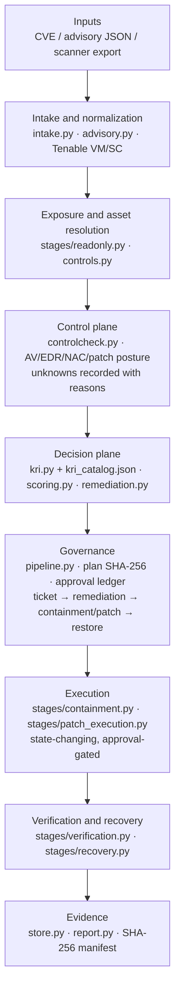
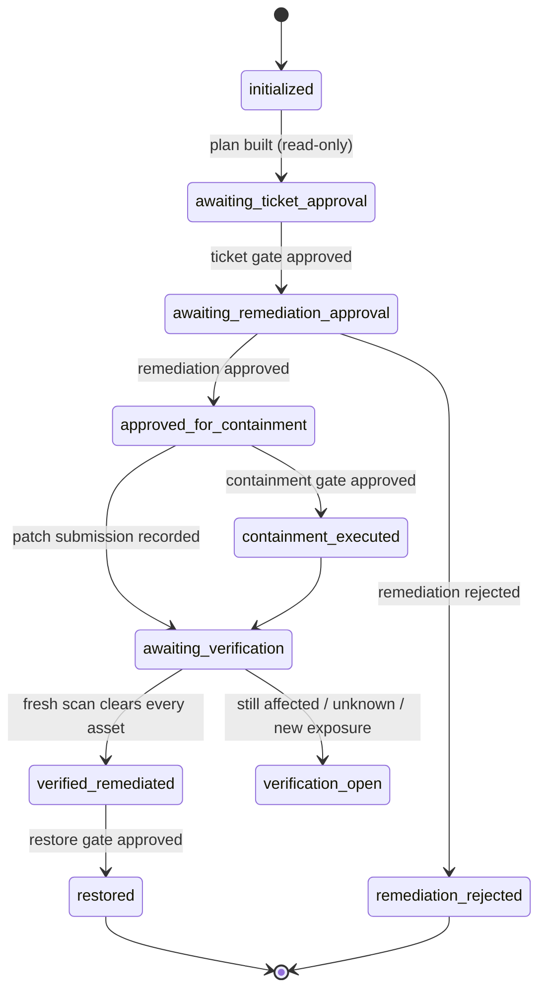

# Architecture — SecOps Autopilot (post-redesign)

This document describes the architecture after the stage-contract refactor. It
keeps the original objective — carry an identified vulnerability to a verified,
evidenced fix — and makes each step independently testable, auditable, and
replaceable.

The source of truth for behavior is the code:

- stage contracts: `secops_autopilot/stages/contracts.py`
- read-only stages: `secops_autopilot/stages/readonly.py`
- action stages: `secops_autopilot/stages/ticketing.py`,
  `containment.py`, `patch_execution.py`, `verification.py`, `recovery.py`
- advisory/version logic: `secops_autopilot/advisory.py`

## 1. Why the redesign

The previous implementation worked, but it had five structural problems that
would not survive a second vulnerability class or a production review.

| # | Gap in the previous design | Consequence | Change in this design |
|---|---|---|---|
| 1 | One 1,479-line `Pipeline` method orchestrated every stage | Stage boundaries existed only in comments; output, retries, and audit records drifted | Explicit `StageContract` records; read-only and state-changing stages live in separate modules |
| 2 | No stage-8 execution connector | The engine could plan a patch but had no record that an approved patch job was submitted | `PatchConnector` + `SimulatedPatchManager`; `approve --gate patch`; jobs labeled simulated, `touched_host=false` |
| 3 | KRI-05 was hard-coded to MS17-010 | Every non-Windows CVE produced `not_applicable`; PHP/Node.js risk was invisible | KRI-05 is target-CVE generic; KRI-08 compares runtime CPE versions to advisory fixed versions; KRI-09 assesses external exposure |
| 4 | Intake accepted only a CVE and Tenable data | No fixed versions, support status, or vendor mitigations; no way to say which source was verified | Advisory JSON with provenance; version-range evaluation; explicit source conflicts; fixed versions flow into the plan and patch stage |
| 5 | Per-stage evidence existed but no single management view | Executives had to read raw JSON to find the numbers | Every run writes `executive-summary.md`; the live batch writes one consolidated report in Markdown, HTML, and PDF |

The safety model was preserved and extended: read-only until a gate, plan SHA
binding, no invented values, fresh-read verification, restore after a separate
approval.

## 2. Layer map

The layer map is rendered dynamically from the Mermaid source rather than stored
as fixed ASCII art, so the same diagram works in GitHub, IDE previews, and
generated documentation.

## 3. Stage contracts

Every stage declares what it consumes, what it produces, whether it can change
state, whether it is retryable, and which approval gate authorizes it. The
contract is written into the stage record, so the evidence package shows the
authorization boundary rather than relying on a reviewer to remember it.

| Method stage | Contract id | Kind | Gate | Key output |
|---|---|---|---|---|
| 1 Risk intake | `intake` | read | — | normalized vulnerability + advisory provenance |
| 2 Exposure | `exposure` | read | — | affected assets, owner, criticality, confidence |
| 3 Control check | `control_check` | read | — | per-asset control posture and unknowns |
| 4 KRI identification | `kri_register` | read | — | eight-indicator KRI status per asset |
| 4 Risk scoring | `kri_scoring` | read | — | 0–100 score, tier, drivers, unknown components |
| 5 Remediation planning | `remediation_planning` | read | — | patch path, target versions, controls, workarounds |
| 6 Ticket creation | `ticket` | state | `ticket` | ticketing-system ticket bound to plan SHA-256 |
| 6 Infosec approval | `remediation_approval` | state | `remediation` | approval or rejection ledger entry |
| 7 Containment | `containment` | state | `containment` | NAC event or blocked identity record |
| 8 Remediation execution | `patch_execution` | state | `patch` | patch jobs, target versions, simulation flag |
| 9 Verification | `verification` | read | — | fresh-read result and EDR baseline status |
| 9 Restore | `recovery` | state | `restore` | restore events for verified assets only |
| 10 Evidence | `evidence` | evidence | — | Markdown/HTML report and SHA-256 manifest |

Methodology stages 9 and 10 in the source document are merged as
**Verification and recovery**: verification is the fresh read, recovery is the
separately approved restore. They are intentionally not one atomic action,
because a green verification result must not automatically release a quarantined
host.

`secops stages` prints this table from the runtime registry, so documentation
cannot silently diverge from the contracts.

Read-only means "cannot change an asset or control-plane state." A read-only
stage can still declare non-destructive side effects. `evidence` writes report
files; verification records EDR status as baseline control evidence. Those are
records, not containment or remediation; the contract lists them in
`side_effects`.

## 4. Data model and provenance

### 4.1 Vulnerability record

`VulnerabilityRecord` now carries:

- `advisory`: the supplied advisory object, including source URL, published
  date, severity system, affected ranges, and provenance.
- `fixed_versions`: product/branch/fixed-version entries with support status.
- `mitigation_steps`: vendor or analyst mitigations, each with `verified: false`
  unless a test says otherwise.
- `provenance`: status (`verified`, `provided`, `unverified`), source URL,
  retrieval time, method, and verifier.
- `conflicts`: scanner/advisory disagreements (for example, scanner says no
  patch while the advisory lists a fixed release).

An advisory that claims `verified` must have a source URL and retrieval time;
the loader rejects it otherwise. The engine never fetches or silently trusts an
advisory by itself.

### 4.2 Unknown values

`unknown` is a first-class value, not an empty string and not a guess. It appears
with a reason and a source on the owning record:

- agent version/feed when Tenable's agent scope is unavailable;
- EDR/AV state when no control connector supplied it;
- patch prerequisites and rollback;
- a runtime version when CPE does not expose one;
- NAC identity when the asset has no MAC.

`unknown` is never treated as clear in a KRI. KRI-08 is `unknown`, not
`not_detected`, when the CPE has no version or no advisory is attached.

### 4.3 Evidence records

Each stage writes `runs/<run-id>/stages/NN-<stage>.json`. Finalization also writes
`executive-summary.md`, a one-page management view of the same run records. The stage record
includes the contract id, methodology stage, kind, gate, attempt, duration, source
calls (last 50), unknowns, errors, and a SHA-256 manifest entry. `run.json` is the
replayable state; reports are generated from the same records.

## 5. State machine and approvals

- A plan modification invalidates every prior approval because each approval
  stores the plan SHA-256.
- Ticket creation, infosec approval, containment, patch execution, and restore
  are separate gates with named approvers.
- KRI-06 routes to containment. EDR is a baseline control, like AV; it does not
  create a separate escalation state or block restore.
- A rejected remediation blocks containment and patch execution.

## 6. Error handling

The design distinguishes four failure classes:

| Class | Example | Behavior |
|---|---|---|
| Configuration/intake | malformed CVE, advisory CVE mismatch, invalid catalog | Fail before any state change with `ConfigError`/`IntakeError` |
| Optional telemetry | agent inventory 403, optional control row missing | Record `unknown` with reason; continue |
| Connector failure | scanner timeout, NAC rejected a request | Typed `ConnectorError`; stage record with error; state-changing stage stops; no retry of a consequential action |
| Unexpected stage failure | bug in a detector or plan builder | Stage runner records `stage_failed`, `next_actions`, finalizes evidence, and raises |

Read-only stages can be retried safely; state-changing stages are never
automatically retried. The connectors themselves retry transient HTTP errors with
backoff, but the engine does not replay a containment or patch submission after
an ambiguous failure. Idempotency is implemented at the connector/action boundary
(ticket creation is status-gated, NAC quarantine is keyed by MAC, patch jobs are
keyed by `(run_id, asset_uuid)`, restore is limited to eligible events).

## 7. KRI model after the redesign

The catalog is data-driven (`secops_autopilot/kri_catalog.json`). The new
definitions close the Windows-only gap:

- **KRI-05 — Unresolved exploitable vulnerability**: target-CVE generic; matches
  the target CVE or legacy markers. Reports finding state, exploit signals, and
  patch availability. `not_applicable` only when the target is not represented on
  that asset.
- **KRI-08 — Vulnerable runtime version**: parses CPE product/version and
  evaluates advisory ranges. Detects below fixed version, and detects an affected
  unsupported branch with no vendor fixed version. `unknown` when CPE has no
  version or no advisory is attached.
- **KRI-09 — Externally exposed vulnerable service**: web port/service or asset
  exposure score at/above threshold. `unknown` when no port, service, or exposure
  score is recorded; it never infers "internal" from silence.

KRI-01 … KRI-04 and KRI-06 keep their original meanings. EDR remains a baseline
control, like AV, and contributes presence, version, feed, and mode evidence to
KRI-01 … KRI-04 rather than a separate active-compromise KRI.

## 8. Live batch execution and reporting

The separate scenario pack was removed. The remaining verification path is the
live batch runner and the unit/integration suite:

1. `scripts/live_php_node_batch.py` queries `/workbenches/vulnerabilities` and
   filters PHP/Node.js plugin families.
2. It exports the matching findings and derives the CVE set from actual scanner
   data.
3. It runs the production read-only `Pipeline` for each CVE and records the
   resulting run state and stage contracts.
4. It writes one consolidated management report in **Markdown, HTML, and PDF**,
   plus one `executive-summary.md` per run.
5. Unit/integration tests use deterministic fixtures for the approval chain,
   KRI logic, advisory ranges, stale-scan handling, evidence integrity, and
   executive-summary generation.

The live reports use real scanner reads with simulated ticketing, NAC, EDR, and
patch connectors. They do not prove production remediation or patch delivery.

Verification enforces scan freshness: an absent finding is `remediated` only
when `last_scan` is within `SECOPS_VERIFICATION_MAX_SCAN_AGE_HOURS` (default 72).
A stale or missing timestamp becomes `unknown`, records a
`verification_scan_stale` event, and keeps the run open. The stale-scan unit test
locks this behavior.

## 9. Extension points

- **Vulnerability source**: implement `VulnerabilitySource` for another scanner
  or a normalized scanner export. The fixture source used by tests is the reference implementation.
- **Control plane**: the current EDR/AV/patch-agent data comes from an inventory
  CSV or the EDR connector. A live control-portal adapter should implement the
  same `ControlPosture` fields and keep source labels on every value.
- **Patch manager**: implement `PatchConnector.submit` for SCCM, Intune,
  Satellite, Ansible AWX, or Tanium. Keep `simulated=False` only when the adapter
  actually contacted the system; never report a host as patched without scanner
  verification.
- **Ticketing/NAC**: existing protocols and adapters; add idempotency keys and
  preserve the `simulated`/`live` labels.
- **Advisory feed**: the JSON schema is intentionally small; a future fetcher can
  populate it from NVD, vendor advisories, or an internal intelligence platform,
  but the provenance fields must be filled truthfully.

## 10. Operational metrics

Recommended metrics, all derivable from the run records:

- stage success rate and `unknown` rate per stage;
- time from intake to ticket, containment, patch submission, and verified fix;
- percentage of assets with a verified fixed version (KRI-08);
- containment block rate due to missing MAC/identity;
- verification freshness (scan timestamps vs. remediation time);
- approval latency by gate;
- evidence integrity failures;
- false-clear rate: KRI unknown treated as clear (target: zero).

## 11. Limitations

- The live Tenable Vulnerability Management path is the only live-validated
  scanner integration. Security Center and ISE adapters follow documented APIs
  but are marked not live-validated in this environment.
- Ticketing, NAC, EDR, and patch management are simulated by default.
- The engine does not exploit, patch, reboot, or execute on endpoints.
- Advisory metadata is supplied input; the engine validates shape and provenance
  but does not independently re-verify a vendor advisory.
- Multi-CVE batch scheduling, asset inventory synchronization, and RBAC are roadmap items,
  not implemented capabilities.
