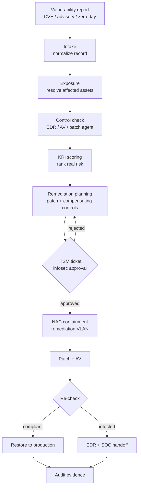

# Playbook: Vulnerability to Verified Fix

The end-to-end chain. One vulnerability in, one evidenced fix out.

## Chain



## Implementation

```bash
# Read-only: intake -> exposure -> control check -> KRI -> plan
secops run --cve CVE-2017-0144

# Gate 1: create the ITSM ticket
secops approve --run <RUN_ID> --gate ticket --approver "<name>"

# Gate 2: infosec approves remediation and enables containment
secops approve --run <RUN_ID> --gate remediation --approver "<infosec>"

# Gate 3: execute NAC containment for the approved candidates
secops approve --run <RUN_ID> --gate containment --approver "<name>"

# Re-query Tenable and compare to the exposure set
secops verify --run <RUN_ID>

# Gate 4: restore only verified-remediated, non-infected assets
secops approve --run <RUN_ID> --gate restore --approver "<name>"

# Evidence
secops report --run <RUN_ID> --format html --verify
```

## Stages

### 1. Intake — `secops run`
Normalize the CVE into one record: Tenable plugin mapping, affected products,
exploitation signals, patch availability and references, source list, confidence.

**Gate:** low/unknown confidence is recorded and surfaced; it does not proceed to
containment on its own.

### 2. Exposure — `secops run`
Resolve affected endpoints and servers from the Tenable findings export. Attach
an owner from the optional owners CSV. Assets with no owner mapping are flagged,
not silently dropped.

**Gate:** assets with no owner are flagged.

### 3. Control check — `secops run`
Per asset: Tenable agent flag, agent record where the API scope permits, last
scan, and EDR/AV/application-control fields from the optional control inventory.
Every missing field is `unknown` with a reason.

### 4. KRI scoring — `secops run`
Rank by severity, exploitability, exposure, control gap, and criticality — not
raw CVSS alone. The component arithmetic and unknown list are in the report.

### 5. Remediation planning — `secops run`
Patch path first. For assets that cannot patch on schedule, select compensating
controls matched to the exploit mechanism (IPS signature, SIEM rule, WAF rule,
firewall block, configuration change). Every control is `verified: false` until
tested. Every asset gets a path: `patch`, `compensate`, or `isolate`.

### 6. Ticket — `secops approve --gate ticket`, then `--gate remediation`
Create the ticket with the plan and evidence. Infosec approval is the second
gate. The approval binds to the plan SHA-256.

**Gate:** human infosec approval required before stage 7.

### 7. Containment — `secops approve --gate containment`
NAC (Cisco ISE) moves non-compliant devices to a remediation VLAN. Assets without
a MAC are recorded as blocked, not guessed.

**Gate:** requires the stage 6 approval.

### 8. Verification — `secops verify`
Re-query Tenable. Compliant → restore is proposed. Still affected → isolation is
retained and the owner is escalated. Infected → EDR/SOC handoff with the evidence.

### 9. Evidence — every stage, then `report`
The full run record: every stage, approval, containment event, verification
result, unknown, and the SHA-256 manifest.

## Design principles

- **Approval before action.** Three state-changing gates plus the restore gate.
- **Unknowns are recorded, never invented.** The evidence package is only as
  trustworthy as its worst guess — so there are no guesses.
- **Compensating controls are not patches.** Say what they do not cover.
- **Read-only until approved.** Stages 1–5 run unattended; stages 6–9 do not.
- **Simulation is labelled.** ITSM, NAC, EDR, and SIEM are file-backed unless a
  live connector is configured; the report says which.

## Status

Implemented. Tenable Vulnerability Management is live-tested. The Security Center
and Cisco ISE adapters follow documented APIs but are marked not live-validated.
ITSM, EDR, and SIEM default to simulated backends.
